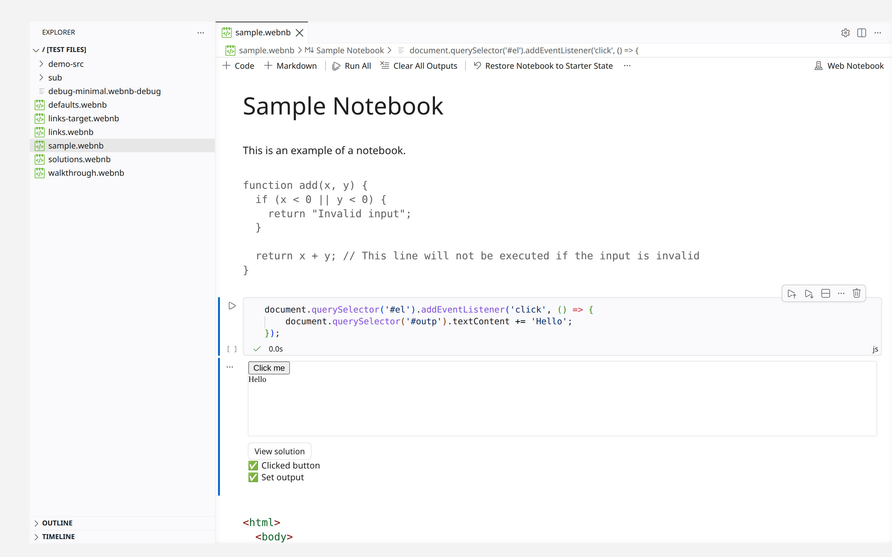

# Web Notebook

Interactive coding tutorials in VS Code, written as plain Markdown.

A `.webnb` file is a Markdown document whose fenced code blocks are live,
editable cells. Learners edit HTML, CSS, JavaScript, Node, or React right in
the notebook, run it, and see rendered output and pass/fail test results
inline — no server, no build step, no toolchain for them to install.



## A notebook is just Markdown

Prose is Markdown. A cell is a fenced block with a language in braces, and
`+` blocks attached underneath supply the fixture, the tests, and the answer:

````markdown
# Adding a click handler

Make the button append "Hello" to the output box.

```{js}
// your code here
```
```+html
<button id="el">Click me</button>
<div id="outp"></div>
```
```+test
assert('#el').click().run('Button did not respond', 'Clicked button');
assert('#outp').should('have.text', 'Hello').run('No output yet', 'Set output');
```
```+solution
document.querySelector('#el').addEventListener('click', () => {
    document.querySelector('#outp').textContent += 'Hello';
});
```
````

Because the source is Markdown, notebooks diff and review like ordinary text
files in git.

## What you can put in a notebook

- **Runnable cells** — HTML, CSS, JavaScript, Node, ES modules, and React
  (JSX), with syntax highlighting and a live output pane.
- **Tests** that grade a learner's work and report each assertion as a green
  check or a red x, with the failure message you wrote.
- **Multiple choice questions**, with feedback per answer or per question.
- **Code walkthroughs** that step through real files in the workspace,
  highlighting a region at a time with your annotations beside it.
- **Workspace checklists** that watch the learner's actual files and tick off
  goals as they edit them.
- **A simulated terminal** for command-line exercises.
- **Solutions and starter code** — reveal an answer on demand, reset a cell
  back to its starting state, or restore the whole notebook.
- **Links between notebooks**, so a course reads as a connected set of pages.

## Getting started

1. Install the extension.
2. Create a file ending in `.webnb` and write some Markdown in it.
3. Open it — VS Code opens `.webnb` files as Web Notebooks automatically.

To author rather than take a notebook, turn off `webnb.lockCellStructure` so
you can add, remove, and reorder cells.

## Settings

| Setting | Default | What it does |
| --- | --- | --- |
| `webnb.lockCellStructure` | `true` | Stops cells being added, removed, or reordered. Contents stay editable, so learners can still edit code and answer questions. Turn off to author. |
| `webnb.allowRevealingSolutions` | `true` | Shows the "View solution" and "Show Answer" buttons. Turn off during an assessment. |
| `webnb.lockMarkdown` | `false` | Makes prose cells read-only so instructions stay intact; code cells stay editable and runnable. |
| `webnb.readOnly` | `false` | Makes `.webnb` files fully read-only, for notebooks meant purely for reading: nothing is written back, not saved answers or terminal history. It works by adding `**/*.webnb` to `files.readonlyInclude` in the same settings scope, and removes only that again when turned off. |

## Authoring reference

**[SYNTAX.md](SYNTAX.md)** documents every cell type, addon, test helper, and
widget: the cell format, tests, automatic running, multiple choice questions,
external checks, and code walkthroughs. It is standalone, so a course repo can
link to it directly.

Working examples of every cell type live in
[`samplenotebooks/`](samplenotebooks/);
`samplenotebooks/walkthrough.webnb` is a complete walkthrough over
`samplenotebooks/demo-src/`.

## License

MIT — see [LICENSE](LICENSE).

---

# Developing this extension

Everything below is for working on the extension itself.

## Coursera Docker Dev

From this repo, build/import the extension into the Practical JavaScript
Coursera Docker harness and start code-server with:

```bash
npm run coursera:start
```

When this checkout is the course repo's `vscode-extensions/vscode-webnb`
submodule, the command finds the course repo on its own. Otherwise it looks for
`~/teaching/Practical-JavaScript`, then for a `Practical-JavaScript` checkout
next to this one (or one level up). A folder counts as the course repo when it
holds `coursera/docker-dev/dev.sh` (or `tools/coursera-docker-dev/dev.sh`, its
location before the course's 2026-08 restructure). To see which repo would be
used, without running anything:

```bash
node scripts/coursera-docker-dev.js where
```

If the course repo lives somewhere else, pass it once:

```bash
npm run coursera:start -- --repo /path/to/Practical-JavaScript
```

or set:

```bash
export PRACTICAL_JAVASCRIPT_REPO=/path/to/Practical-JavaScript
```

To import the VSIX without starting the container:

```bash
npm run coursera:import
```

To stop the Coursera Docker dev container:

```bash
npm run coursera:stop
```

`coursera:start` skips the harness's content rebuild by default; pass
`-- --prepare` to rebuild the notebooks, assignments, and vendored extensions
first. Import, start, and that rebuild all use this extension checkout as the
web-notebook source, so they do not depend on your shell being inside the
course repo.

## Development Loop

For a faster VS Code Web development loop, run:

```sh
npm run in-browser:watch
```

This watches the source files, runs webpack development builds as they change, waits for the first successful build, launches VS Code Web, opens `samplenotebooks/sample.webnb`, and reloads VS Code Web whenever the compiled output changes. The wrapper also reopens the target notebook on each reload signal so the file stays in front.

If you only want webpack watching without opening VS Code Web, run:

```sh
npm run dev:web
```

The browser launch uses `scripts/vscode-test-web.js`, a small wrapper around the `@vscode/test-web` API. It opens `samplenotebooks/sample.webnb` by default through the npm scripts above. With `--watch`, the wrapper rebuilds with webpack after source changes, watches the compiled extension output in `out/` plus `package.json`, and reloads VS Code Web after a rebuild.

You can launch once without the reload watcher:

```sh
npm run in-browser:open
```

You can also pass a different file path with `--file`:

```sh
npm run test-web -- --file sample.webnb
npm run test-web -- --workspace . samplenotebooks/sample.webnb
```

`vscode-test-web` does not watch or reload by itself. The `--watch` flag in `scripts/vscode-test-web.js` adds that development loop around it. The regular `npm run in-browser` command still does a one-time development build before launching.

### Remote Development

When this repo runs on a remote machine (SSH, a container, code-server), the launcher cannot open a browser there. Use remote mode instead:

```sh
npm run in-browser:remote
```

This runs the same watch/rebuild/reload loop but skips launching a browser and prints the URLs to open from your own machine. The rebuild-and-reload signal resolves against whatever origin your browser connected through, so live reload works across tunnels and mapped ports.

If you forget `--remote` on a machine with no display, the launcher notices ($DISPLAY / $WAYLAND_DISPLAY are unset on Linux) and falls back to this server-only mode automatically instead of crashing on the browser launch.

The server binds to `localhost` by default, so forward the port from your local machine first:

```sh
ssh -L 3000:localhost:3000 <user>@<remote-host>
```

then open `http://localhost:3000/` locally.

The address in your browser must literally be `localhost` — not `127.0.0.1`, not a LAN IP, not a machine name. Two separate things break on any other origin:

- Browsers grant plain-HTTP [secure-context](https://developer.mozilla.org/en-US/docs/Web/Security/Secure_Contexts) APIs (like `crypto.subtle`, which VS Code Web requires) only to `localhost`.
- `@vscode/test-web` serves the web-worker extension host from a generated subdomain of whatever host the browser used (`v--<uuid>.localhost` resolves to loopback in every browser; subdomains of IP addresses are invalid URLs and subdomains of ordinary hostnames do not resolve).

On a non-localhost origin the workbench shell still loads, but the extension host cannot start, so the Explorer shows no files (`ENOPRO: no file system provider for vscode-test-web://mount`) and no extensions run. In server-only mode the launcher prints this requirement next to the URL to open.

`--host 0.0.0.0` is still useful whenever the port is reached through a mapping that ends in a localhost URL: a Docker/devcontainer port map (`-p 3000:3000`), `kubectl port-forward`, or an SSH tunnel all qualify.

`--remote` is shorthand for `--browser none` and works with any of the launcher's modes. The server has no authentication: anyone who can reach the port can read this whole extension checkout (dotfiles included) and the mounted workspace as static files, and gets a full VS Code Web session on the workspace (edits stay in browser memory and are not written back to disk). The launcher prints a warning whenever it binds anything but localhost; on shared networks, keep the default bind and use a tunnel.

## Verifying course notebooks (yours or another repo's)

`scripts/verify-notebooks.js` renders and runs every cell of every `.webnb`
in a workspace through the extension's real `render()` (via the preview
harness) and reports whether the content is structurally healthy: every
notebook parses and loads, every code cell renders (a render that throws, or
a cell left with no output, fails), and nothing throws an uncaught page error.
Exercise checks that intentionally start unsatisfied (checklists, tests a
learner must make pass) are listed as warnings, not failures, and so are
errors a cell's code throws later (a timer, a listener, a rejected promise),
which the renderer prints in that cell's console as "Uncaught ...".
`--strict-feedback` promotes them all.

`--solutions` checks the answers instead: every HTML, CSS, JavaScript, Node,
and React cell that has a `+solution` is rendered with that solution in place
of its source (the preview's `?solutions` mode; nothing is copied or written),
and any error feedback or uncaught error from such a cell fails the run.
Cells without a `+solution` keep the normal rules, because some lessons show
an error on purpose.

```sh
npm run verify:notebooks -- /path/to/course --solutions
```

From a course-content repo, with this repo checked out and `npm install`-ed
next to it:

```sh
node ../vscode-webnb/scripts/verify-notebooks.js
```

From this repo, pointing anywhere:

```sh
npm run verify:notebooks -- /path/to/course
```

Useful options (see `--help` for all): `--notebook <substr>` verifies a single
notebook, `--json out.json` dumps the raw per-cell capture, `--port <n>`
changes the preview port.

### Regression baselines for a course repo

`--baseline` gives any course repo the same golden-diff workflow this repo's
`npm run test:harness` uses for `samplenotebooks/`, with the baseline
committed in the *course* repo:

```sh
# once, and after every intentional content change:
node ../vscode-webnb/scripts/verify-notebooks.js --baseline .webnb-baseline.json --update-baseline

# in CI or before publishing:
node ../vscode-webnb/scripts/verify-notebooks.js --baseline .webnb-baseline.json
```

The capture has one entry per code cell, in document order: what its output,
feedback, console, and action strip ("View solution", "Reset code") show,
whether it ran on open, whether its render threw, and how its multiple choice
question grades with the revealed answer (see the header of
`tests/lib/capture.js`). A baseline saved by an older version of the capture
is reported as out of date rather than diffed cell by cell; refresh it with
`--update-baseline`. A `--solutions` run needs a baseline of its own.

### CI for a course repo

```yaml
jobs:
  verify-notebooks:
    runs-on: ubuntu-latest
    steps:
      - uses: actions/checkout@v4
      - uses: actions/checkout@v4
        with: { repository: soney/vscode-webnb, path: .webnb-harness }
      - uses: actions/setup-node@v4
        with: { node-version: 24 }
      - run: npm ci
        working-directory: .webnb-harness
      - run: npx playwright install --with-deps chromium
        working-directory: .webnb-harness
      - run: node .webnb-harness/scripts/verify-notebooks.js $GITHUB_WORKSPACE
```

(The second checkout lands the harness inside the course checkout, so pass the
course root explicitly rather than relying on the default working directory.)

## Releasing

`npm run gen-vsix` builds and packages `web-notebook.vsix`. Bump `version` in
`package.json` and add a `CHANGELOG.md` entry before publishing with
`npx vsce publish --no-dependencies`, the same flag `gen-vsix` uses. Webpack
already bundles every runtime dependency into `out/`, so vsce's npm dependency
scan has nothing to add, and on this tree it breaks packaging outright (vsce
reports the `out/extension` entry points as missing).

`npm run check:vsix` packages the extension into a temporary folder and fails
if anything ships outside the expected files (`out/client`, `out/extension`,
`out/markdownItPlugin`, `icons/`, and the top-level docs and manifests), if an
entry point `package.json` names is missing, or if the VSIX grows past 2 MiB.
CI runs it on every push.
